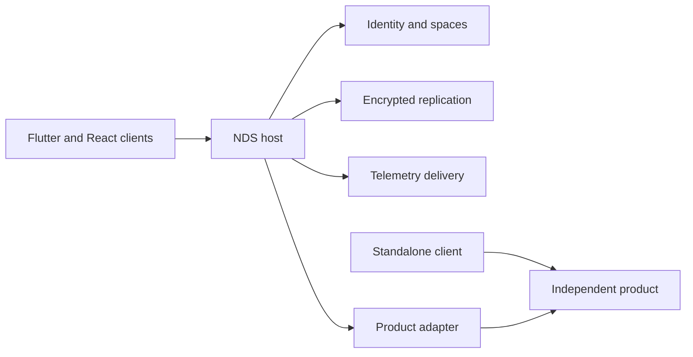

# Architecture

NDS is the host and integration layer for independent products. Its common
capabilities are identity, device and space context, synchronized settings and
state, module lifecycle and telemetry. A product owns its engine, public interface,
state model and standalone application or service.

## Current composition

Core contains pure domain rules and application use cases. Protocol owns wire
schemas. Accounts handles authentication, enrolled-device proof and native/browser
credential adapters. Vault owns encrypted local records, the durable journal and
replication runtime. Server enforces current authority and commits synchronized
operations. Organizations composes the membership API through Accounts.

Agent composes eight native integrations: sysinfo, clipboard, cleaner, updater,
GitHub, remote, browser-use and cache. Its bounded process/socket I/O is shared by
those integrations. Desktop contains both Flutter presentation and the shared Rust
composition used by native clients and Web. Mobile reuses the shared Flutter
packages; Web uses React and the shared Rust/WASM behavior.

These are compiled dependencies. The current descriptor graph and capability
checks do not implement module installation, hot replacement or a general RPC/WIT
host. Choosing and implementing that runtime is a separate refactor.

## Responsibility boundaries

| Boundary | Responsibility |
| --- | --- |
| Independent product | Its engine, APIs, standalone entry point, local state and releases |
| NDS adapter | Translate product APIs into NDS identity, lifecycle, synchronization and diagnostic context |
| NDS kernel | Shared identity, spaces, device policy, storage and replication contracts |
| Client assembly | Compose implemented adapters, platform lifecycle and presentation |
| Source root | Select component source and validate the assembly metadata |

The adapter retains the initiating actor, device, space and operation through its
whole lifetime. Changing a selection does not transfer an older operation's
authority. Products retain their own native permission and endpoint checks.

An adapter does not duplicate the product engine. Standalone initialization and
NDS initialization have separate composition roots; embedding a library does not
silently start another account service, replica or telemetry subscriber.

## State

Replicated desired state, device-local state, observations and commands/media
have different lifetimes. Module settings can be synchronized. OS credentials,
local paths, live handles and endpoint keys remain local. Health observations
describe what was actually seen. Replaying synchronized state does not replay a
browser action, remote input or an application update.

The existing Vault journal uses immutable dispatched operations, explicit
conflicts, tombstones and bounded history/checkpoint recovery. Its current server
provisions owner keys and has decryption authority; the implementation does not
provide client-only end-to-end encryption. A future data-model decision must
preserve existing encrypted originals, pending work and key ownership.

## Refactor boundary

Independent product ownership is the selected direction. Versioned process APIs
and Wasm component interfaces are candidates for module hosting where needed.
This preparation chooses neither a new wire contract nor a new synchronization
algorithm. Native access, module replacement, state migration and platform
acceptance need concrete consumers and coordinated implementation.
