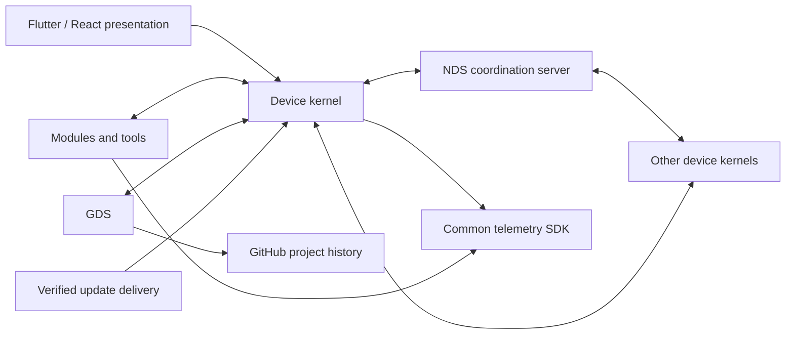

# System architecture

NDS is a distributed user system with an extensible kernel, functional modules,
tools and a synchronization server. [ADR 0017](decisions/0017-extensible-offline-kernel.md)
records the owner-selected target and transition from the earlier adapter-only,
compiled-in composition. Existing releases do not acquire new behavior from
this document.

## Boundaries

Direct device connections require reachable endpoints and valid scoped authority;
offline permission does not make an unavailable relay or target reachable.

| Boundary | Owns |
| --- | --- |
| Kernel domain | Stable identity, spaces, device policy, common authorization, synchronization and lifecycle invariants |
| Kernel application | Use cases and ports for identity, connections, storage, sync, modules, updates and observations |
| Kernel runtime | Concrete bounded composition, durable local stores, connector and retained operation/resource ownership |
| Functional module | Its domain decisions, engine, scoped state, public contract and native/provider adapters |
| Tool | A focused bounded function using the same admission, result and lifecycle contract where applicable |
| Coordination server | Authenticated control state, encrypted journal/store, delivery progress and connection coordination |
| Presentation | User interaction and generated typed boundaries; no independent authorization or sync engine |

The kernel is implemented by existing component owners, not a new global daemon.
Applications and agents use the same action boundary with fullauto/manual
profiles under [ADR 0018](decisions/0018-control-and-diagnostic-profiles.md).
Fullauto gives the trusted agent complete control inside its actor's space,
without an NDS sandbox or per-action permission prompts. Manual exposes narrower
choices. Current actor, target identity and space separation remain explicit;
telemetry and a caller-supplied mode cannot grant authority.
Domain imports no async runtime, filesystem, SQL, HTTP or UI libraries. Application
ports describe behavior and its bounds; adapters own I/O. Module-specific GitHub
and remote-display algorithms belong to their modules. Common policy is not
reimplemented in every module, and a concrete module does not become a required
import of the pure kernel just to be registered.

## Component ownership

Repository membership and runtime extension membership are different. The source
[catalog](../contracts/module-catalog.json) contains these 24 repository boundaries. Paths,
Gitlinks, declared platforms and release status remain owned by that catalog.
This table assigns target responsibility, not runtime readiness.

| Component ID | Target role and responsibility |
| --- | --- |
| `core` | Kernel domain/application: common invariants and ports |
| `protocol` | Canonical wire, lifecycle, sync and release contracts; generated projections |
| `accounts` | Kernel identity, device proofs, credentials and server connector |
| `organizations` | Kernel personal/organization membership and scoped client operations |
| `vault` | Kernel encrypted records, secret references and durable replica/outbox |
| `agent` | Native kernel composition, module/tool supervision and operation ownership |
| `desktop` | Shared Rust composition, Flutter shell, generated bridge and native launcher integration |
| `mobile` | Mobile shell/assembly and platform lifecycle/distribution adapters |
| `web` | React shell/assembly, shared Rust/WASM and qualified browser storage/lifecycle |
| `server` | Coordination, authenticated control state and durable delivery |
| `observability` | Common SDK plus collector/query/alert services; one telemetry authority |
| `gds` | Full GitHub project synchronization module and its workspace engine |
| `rds` | Full remote-display module: host, transport/session integration and viewer |
| `browser-use` | Browser automation engine, standalone host and NDS module integration |
| `sysinfo` | Focused system-information tool; observations are not grants |
| `clipboard` | Clipboard tool and explicitly admitted sharing; OS consent remains binding |
| `cleaner` | Bounded resource/cache management tool with its own state |
| `updater` | Verified NDS/module delivery engine and kernel integration; external OS update reporting is a distinct tool capability |
| `cache` | Hosted cache service plus explicit per-device client integration |
| `design-system` | Shared presentation tokens/components and generated visual assets |
| `estate` | Private operational configuration and evidence, never a public runtime plugin |
| `standards` | Private NDDev engineering governance, never an application source dependency |
| `organization` | Public organization introduction and assets, no runtime execution |
| `estate-example` | Synthetic deployment example, never another authorization/runtime authority |

Logical kernel membership does not require merging repositories or relabeling
every package as an independently replaceable executable. Each owner keeps one
implementation, dependency lock and release history. The central source root
contains standards and assembly metadata, not copied component code.

## Devices and workload placement

One enrolled device identity covers servers, workstations and ordinary computers.
Its stable `device_id` and proof are independent of its editable name, deployment
form and purpose profiles. Personal and organization membership do not silently
rebind its key to another principal. Administrative scope, physical ownership,
data ownership and current user authorization must not be inferred from each other.

The purpose profiles below describe intent; they do not replace permissions:

| Profile | Intended workload |
| --- | --- |
| `server-hosting` | Explicitly assigned deployed applications/services |
| `server-dev-desktop` | Remote development agents/LSP and NDS system tools; application execution goes to its assigned host |
| `server-desktop` | General remote desktop/browser use without an assumed development setup |
| `build-dev-desktop` | Development plus explicitly admitted local builds, tests and application execution |
| `dev-desktop` | Local development agents/code work and system tools; applications execute on assigned hosts |
| `desktop` | General-purpose user computer; available functions are explicitly discovered and admitted |

The same profile can exist in the operator's or a customer's scope. Devices can
have more than one approved purpose; the intersection of organization, device
and project policy decides each launch. An agent-readable descriptor reports
identity, scope, profiles, actual capabilities and placement policy. Ambiguous,
missing or denied placement is a refusal, never permission to run on the caller.

An editable alias is unique within its administrative scope. Use an explicit
scheme such as `<scope-alias>-<site-alias>-<primary-profile>-<index>`; aliases and names
are descriptive, not endpoint discovery or proof of identity. Product source
contains only synthetic examples, never the actual fleet inventory.

NDS, GDS, RDS and intended system tools can run in an admitted development
environment. Unrelated product workloads belong on the hosting/build device
assigned to that project. Kernel-controlled launches enforce this policy; an
agent's unrestricted external shell is not made into an OS sandbox by a label.

## Spaces and state

One authenticated user may use a personal space and multiple organization
spaces. Every module context, stored record, cursor, operation, observation and
credential reference retains its original actor, space and device. Selecting a
different space never reuses the old resource's permission under the new actor.
Personal secrets and project data are not exposed by organization administration.

Four classes have different lifetimes:

1. Replicated desired state: admitted settings, connection intents and module data.
2. Device-local state: keys, physical paths, runtime handles and local bindings.
3. Observations: actual installation, execution, health and freshness on a device.
4. Commands/media: explicit operations and transient streams, not replicated settings.

Modules declare which of their records are replicated and own their payload
schema and semantic conflict policy. The kernel provides scoped encrypted
storage, delivery, revision checks, tombstones and conflict preservation.
Commands with external effects require their own operation/receipt protocol;
replaying a state outbox must not replay an arbitrary browser action or update.
See [synchronization](04-sync-and-data.md) for the canonical operation rules.

## Extension contract and trust

Official and user-developed modules use the same versioned boundary. An installed
module declares its stable publisher/module identity, package version, kernel
API compatibility, required dependencies, supported platforms/roles, requested
permissions, resource bounds and data schema/migration compatibility. Keep one
canonical schema in Protocol and generate projections. A manifest advertises
intent; the effective control profile and actual platform decide admission.
Declared capabilities describe the interface and its required implementation.
They are not a mandatory user-maintained permission checklist in fullauto.

Ordinary compatible module registration must not require editing a built-in enum
or private UI dispatch list. Namespaced module IDs and typed module-owned payloads
extend functionality. New kernel privileges still require an implemented broker
and explicit policy; unknown or self-invented permissions are denied. Existing
descriptor v1 and its closed vocabulary remain immutable for old consumers until
an explicit versioned transition. Do not loosen their validator to accept anything.

Protocol owns the common envelope; each module owns its typed payload schema.
Do not import every future module's domain types into Core or a central UI enum.
Package identity binds publisher and module namespace; a new publisher cannot
replace an official module by choosing its display name.

The public module boundary carries scoped data and capabilities, not kernel
internals, raw Vault keys or archived provider handles. Renderer-specific UI
remains presentation. A module may contribute versioned presentation metadata
or use a qualified client integration; executable Flutter/React code is not
assumed to be dynamically loadable on every platform.

Native independently delivered engines use supervised workers and a versioned
bounded protocol where a process boundary is needed. Kernel libraries and
platform client bundles may remain statically composed. Do not add a native
dynamic-library ABI or a WASM plugin VM without an actual accepted caller.
Reuse existing Agent I/O, task ownership and module lifetimes rather than adding
a second manager or scheduler.

Separate processes improve ownership and crash isolation but are not automatically
a security sandbox. Native same-user code may have the user's OS authority.
The alpha admits trusted official modules; installing a future native extension
requires an explicit trust decision and an honest description of isolation.
Sandboxed untrusted execution requires its own qualified OS/VM boundary before
claiming enforcement. A valid publisher signature proves provenance, not safety.
No extension gets every personal/organization secret merely by being installed.

A standalone product reuses the same engine and public operations with a local
host context and the common SDK. NDS integration supplies admitted identity,
devices, sync and telemetry delivery. It adds no duplicate credential store or
provider engine. Cross-device calls target an exact device/module/resource under
the caller's original scope; they are not a generic remote shell.

## Lifetimes, results and updates

Desired enablement, package installation, current admission, actual running
state, health and telemetry delivery are separate facts. A query can succeed
while readiness is false or an executed script reports failure. Status includes
the observed generation and freshness; a late result cannot describe a replacement.

The runtime owns each admitted task/resource before caller await. Caller loss,
revocation, logout or shutdown denies new calls and retains actual completions.
Keep reserve/write/close effects and their acknowledgements through normal
cancellation. A joined outer task alone does not prove a provider effect or
cleanup. Unknown or missing completion remains sealed and observable.

Replacement seals the exact old generation, cancels interruptible work, joins
owned operations and requires positive exact-resource drain before detaching
or starting a conflicting replacement. Attempt every captured resource even
after an earlier error. Do not convert absence, a project name or a transport
restart into a close acknowledgement. Capacity and queues remain finite.

Each component has its own version. Actual independently installed module
updates and full NDS updates use [release policy](08-release-policy.md).
Controlled restarts are allowed. An application bundle containing a static
library changes only through that bundle's update; a library revision by itself
is not a separately installable module.

## Transition and acceptance

The current compiled-in clients, scoped authorization, durable Vault protocol,
Git workspace engine and owned screen/browser lifetimes are reusable foundations.
Their earlier checks retain their exact source/platform scope. They do not yet
prove multiple spaces, external module delivery or full legacy-independent RDS.

Implement ADR 0017's cohorts through the existing owners and real callers.
Preserve IDs, keys, encrypted records, pending operations, installed modules and
repositories. This target requires deliberate changes to the old `Owner`/tenant
model, device metadata/policy, descriptor/registry and delivery boundary. Never
rename ciphertext ownership or silently reinterpret an existing token during
migration. Source-root catalog entries and Gitlinks are not rollout authority.

Qualify coherent Linux, PC-owned Android emulator and Web workflows for the alpha.
Other platforms retain honest build-only status until their own runtime gates.
Platform capture/renderer roles, offline availability and independently installable
packages must each report their actual support. No placeholder screen, descriptor
or green source graph substitutes for real synchronization, pixels, activation
or searchable common telemetry.
